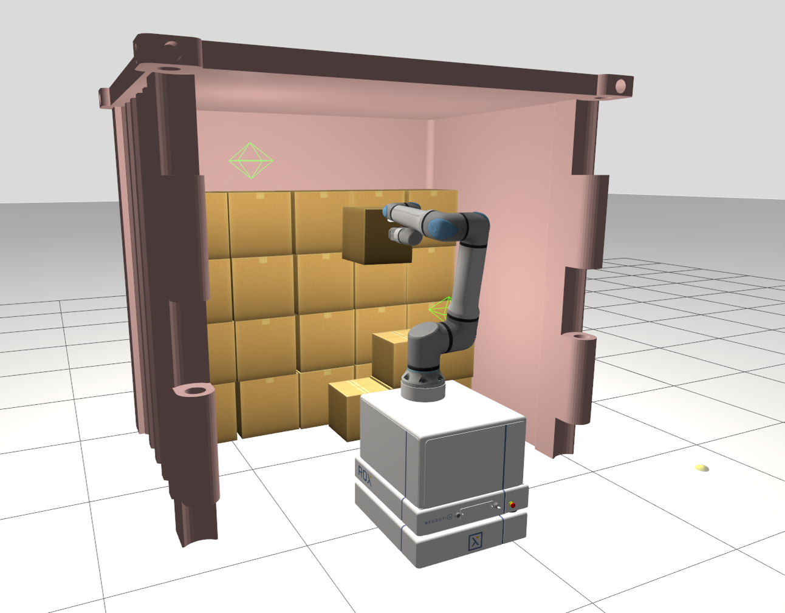

# Container Unloading Simulation Benchmark

A ROS 2 / Gazebo simulation environment for **benchmarking autonomous container-unloading solutions**.

Robotic container unloading lacks publicly available, comparable performance metrics. This package provides a common simulated scenario (a 2 m container mockup loaded with two layers of cardboard boxes of different sizes, and a mobile manipulator) and a metrics extraction script. Anyone can evaluate their own perception, planning or grasping pipeline under the same conditions and compare it directly with the results reported in our paper.



---

## Contents

- [Overview](#overview)
- [Quick start (Docker)](#quick-start-docker)
- [Native installation](#native-installation)
- [Interfaces](#interfaces)
- [Running a benchmark](#running-a-benchmark)
- [Reference results](#reference-results)

---

## Overview

The simulated system consists of:

| Component | Description |
|---|---|
| Mobile base | Neobotix EMROX (`urdf/base/`) |
| Manipulator | Universal Robots UR30 (`urdf/ur30/`, controllers in `config/ur30/`) |
| End effector | Robotiq EPick, single suction cup (`urdf/gripper/`), simulated with a custom contact-based gripper plugin (`plugins/`) |
| Perception | Intel RealSense D435 (`urdf/camera/`) |

### Scenario

A container mockup 2 m long, loaded with two layers of cardboard boxes so that solutions are tested on more than one box size:

| Layer | Box size | Quantity |
|---|---|---|
| Front | 35 cm | 36|
| Back | 45 cm | 20 |

**Tested with:** Ubuntu 24.04, ROS 2 Jazzy

---

## Quick start (Docker)

Docker is the recommended way to run the benchmark, because it reproduces the exact environment used for the paper's results.

### Requirements

- Docker ≥ 24 with Docker Compose v2
- An X server for the Gazebo/RViz GUI (Linux desktop, or WSLg on Windows)
- Optional: NVIDIA GPU with the [NVIDIA Container Toolkit](https://docs.nvidia.com/datacenter/cloud-native/container-toolkit/) for faster rendering

### Build and run

```bash
git clone https://github.com/mariaslopes/container_unloading_sim_benchmark.git
cd container_unloading_sim_benchmark

# Build the image (run from the repository root: the whole repo is the build context)
docker build -f resources/Dockerfile -t container_unloading .

# Allow the container to open windows on your display
xhost +local:docker

# Launch Gazebo and the RViz digital twin
cd resources
docker compose up
```

---

## Native installation

If you prefer to build without Docker:

```bash
# Create a workspace
mkdir -p ~/ws_benchmark/src && cd ~/ws_benchmark/src
git clone https://github.com/mariaslopes/container_unloading_sim_benchmark.git

# Import external dependencies (pinned versions)
vcs import --skip-existing . < container_unloading_sim_benchmark/resources/dependencies.repos

# Remove hardware-only packages that are not needed in simulation
rm -rf rox/rox_bringup \
       rox/rox_rviz \
       rox/rox_navigation \
       ros2_epick_gripper/epick_controllers \
       ros2_epick_gripper/epick_driver \
       ros2_epick_gripper/epick_hardware_tests \
       ros2_epick_gripper/epick_moveit_plugin \
       ros2_epick_gripper/epick_moveit_studio \
       ros2_epick_gripper/epick_msgs

# Install system dependencies and build
cd ~/ws_benchmark
source /opt/ros/jazzy/setup.bash
rosdep install --from-paths src --ignore-src -r -y
colcon build --symlink-install
source install/setup.bash
```

---

## Interfaces

Your solution may only use the interfaces below. Reading ground-truth box poses from Gazebo is not allowed.

| Interface | Type | Use |
|---|---|---|
| `/d435/depth/color/points` | `sensor_msgs/msg/PointCloud2` | Camera point cloud |
| `/d435/infra1/image_rect_raw`, `/d435/infra2/image_rect_raw` | `sensor_msgs/msg/Image` | Infrared images (with `camera_info`) |
| `/d435/trigger` | `std_msgs/msg/Bool` | One message triggers the capture of one point cloud and its images |
| `/joint_states` | `sensor_msgs/msg/JointState` | Arm joint states |
| `/emrox/odom` | `nav_msgs/msg/Odometry` | Base odometry |
| `/emrox/scan` | `sensor_msgs/msg/LaserScan` | Base lidar |
| `/emrox/cmd_vel` | `geometry_msgs/msg/Twist` | Base commands |
| `/joint_trajectory_controller/follow_joint_trajectory` | `control_msgs/action/FollowJointTrajectory` | Arm commands |
| `/epick/suction` | `std_msgs/msg/Bool` | Suction on/off (**required**, boxes are counted from it) |

---

## Running a benchmark

1. Start the simulation and metrics node:
   ```bash
   ros2 launch container_unloading_sim_benchmark sim_bringup.launch.py
   ```
2. Start your solution (with `use_sim_time:=true`).

A run **starts** when the base first moves and **ends** when the base returns to its start pose and stops. If that never happens, it ends after 120 s without activity, or when the metrics node is stopped. Your solution should therefore drive into the container, unload, and drive back to where it started.

When the suction is turned off, the detached box is removed from the world after 5 s. This applies to every released box, whether it was placed on the conveyor or dropped.

The metrics node writes a report of each run to `~/unloading_reports/run_<date>_<time>/` (`report.txt`, `summary.json`, `boxes.csv` and `timeline.png`). Keep its default parameters when reporting results.

---

## Reference results

Results of our solution on the benchmark scenario (single run). Times are given as mean ± std over all boxes in the run.

| Metric | Value | Definition |
|---|---|---|
| Boxes unloaded | 53 | Suction ON → OFF transitions during the run |
| Total time | 686.1 s (11 min 26 s) | From the first base motion until the base returns to its start pose |
| Throughput | 278.1 boxes/h | Boxes unloaded per hour of total time |
| Time per box | 12.6 s/box | (Last release − first grasp) / boxes unloaded |
| Pictures taken | 18 (≈ 2.9 boxes per picture) | Perception triggers sent on `/d435/trigger` during the run |

## Contacts

If you have any questions or you want to know more about this work, please
contact:
- **Maria S. Lopes**
  ([maria.s.lopes@inesctec.pt](mailto:maria.s.lopes@inesctec.pt))
- **Artur Cordeiro, PhD**
  ([artur.j.cordeiro@inesctec.pt](mailto:artur.j.cordeiro@inesctec.pt))
- **João Pedro C. de Souza**([joao.p.souza@inesctec.pt](mailto:joao.p.souza@inesctec.pt))
- **Ricardo Sousa**([ricardo.b.sousa@inesctec.pt](mailto:ricardo.b.sousa@inesctec.pt))
- **Pedro Costa**([pedro.g.costa@inesctec.pt](mailto:pedro.g.costa@inesctec.pt))
- **Manuel F. Silva**([manuel.s.silva@inesctec.pt](mailto:manuel.s.silva@inesctec.pt))